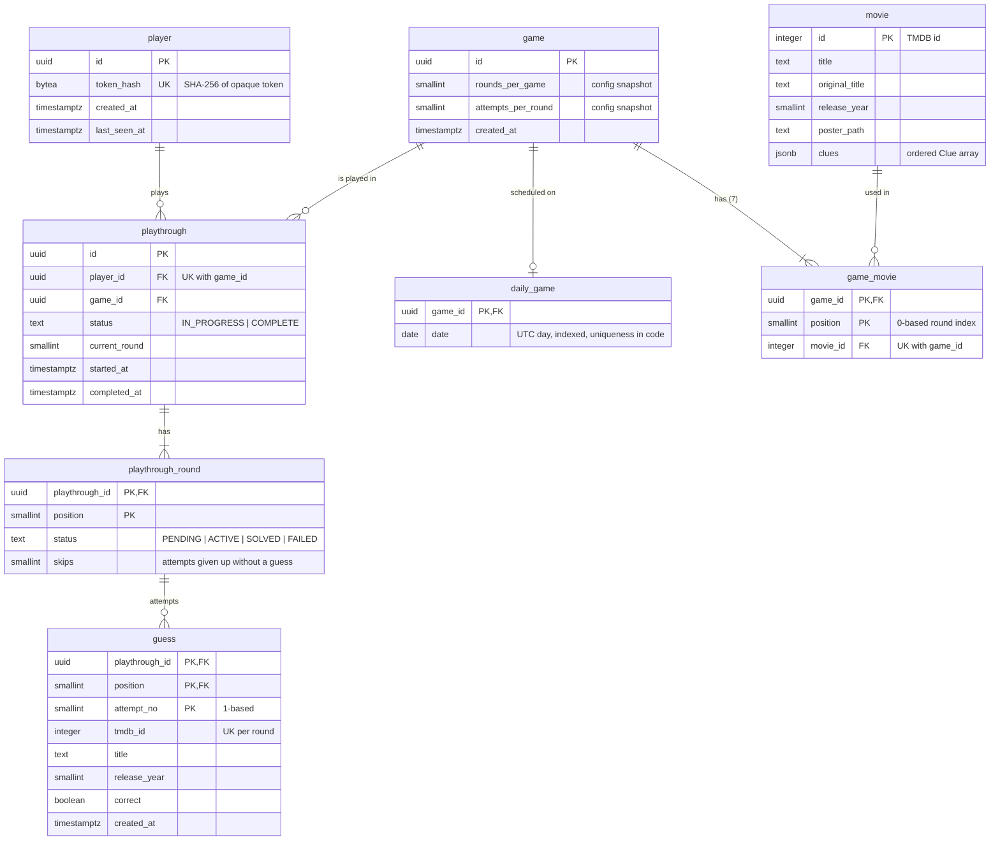

# Database (PostgreSQL)

- Access: Spring Data R2DBC (`r2dbc-postgresql`), repositories as coroutine `CoroutineCrudRepository`; `DatabaseClient` / custom queries where atomicity matters.
- Migrations: **Flyway**, plain SQL under `backend/src/main/resources/db/migration` (`V1__init.sql`, …). Flyway needs JDBC: include `flyway-database-postgresql` and the `postgresql` JDBC driver for startup migration only. Application queries remain R2DBC.
- The database is never purged. Data for each day is retained for ever.
- Primary keys: UUID (generated app-side, UUIDv4/v7) except where a natural key exists.

## Diagram



The model has two halves:

- **Shared, player-independent:** `movie`, `game`, `game_movie` and `daily_game`. A `game` is a fixed list of movies, identical for everyone, and carries the rules (rounds, attempts) it was generated with. `daily_game` says which UTC day a game is played on; it is the only table with the date. `movie` holds everything about a film, including its clues, and has no date.
- **Per player:** `playthrough` and its children. A playthrough is one player's run through a game. A round's movie is not stored on the playthrough: it is `game_movie` at the same `position` in the playthrough's game.

Naming in the API: the `Game` object in the OpenAPI contract is the *player's view* (the shared game plus that player's playthrough), not a table.

## Schema (initial)
The authoritative DDL is `backend/src/main/resources/db/migration/` (`V1__init.sql`, then `V2__sequential_clues.sql`, which rewrote the stored clues into the unlock order and dropped `revealed_clue`, then `V3__skips.sql`, which added `playthrough_round.skips`); this is the resulting schema.

```sql
CREATE TABLE player (
  id           uuid PRIMARY KEY,
  token_hash   bytea NOT NULL UNIQUE,
  created_at   timestamptz NOT NULL,
  last_seen_at timestamptz NOT NULL
);

CREATE TABLE movie (
  id             integer PRIMARY KEY,
  title          text NOT NULL,
  original_title text NOT NULL,
  release_year   smallint NOT NULL,
  poster_path    text,
  clues          jsonb NOT NULL
);

-- A game: a fixed list of movies plus the rules it was generated with. Shared by all players.
CREATE TABLE game (
  id                 uuid PRIMARY KEY,
  rounds_per_game    smallint NOT NULL,
  attempts_per_round smallint NOT NULL,
  created_at         timestamptz NOT NULL
);

-- Which game is played on which UTC day. "One game per date" is enforced by the
-- generator (under an advisory lock), deliberately not by a constraint.
CREATE TABLE daily_game (
  game_id uuid PRIMARY KEY REFERENCES game (id),
  date    date NOT NULL
);

CREATE INDEX daily_game_date_idx ON daily_game (date);

CREATE TABLE game_movie (
  game_id  uuid NOT NULL REFERENCES game (id),
  position smallint NOT NULL,
  movie_id integer NOT NULL REFERENCES movie (id),
  PRIMARY KEY (game_id, position),
  UNIQUE (game_id, movie_id)
);

CREATE INDEX game_movie_movie_idx ON game_movie (movie_id);

-- One player's run through a game.
CREATE TABLE playthrough (
  id            uuid PRIMARY KEY,
  player_id     uuid NOT NULL REFERENCES player (id),
  game_id       uuid NOT NULL REFERENCES game (id),
  status        text NOT NULL CHECK (status IN ('IN_PROGRESS', 'COMPLETE')),
  current_round smallint NOT NULL,
  started_at    timestamptz NOT NULL,
  completed_at  timestamptz,
  UNIQUE (player_id, game_id)
);

CREATE TABLE playthrough_round (
  playthrough_id uuid NOT NULL REFERENCES playthrough (id),
  position       smallint NOT NULL,
  status         text NOT NULL CHECK (status IN ('PENDING', 'ACTIVE', 'SOLVED', 'FAILED')),
  skips          smallint NOT NULL DEFAULT 0,
  PRIMARY KEY (playthrough_id, position)
);

CREATE TABLE guess (
  playthrough_id uuid NOT NULL,
  position       smallint NOT NULL,
  attempt_no     smallint NOT NULL,
  tmdb_id        integer NOT NULL,
  title          text NOT NULL,
  release_year   smallint,
  correct        boolean NOT NULL,
  created_at     timestamptz NOT NULL,
  PRIMARY KEY (playthrough_id, position, attempt_no),
  UNIQUE (playthrough_id, position, tmdb_id),
  FOREIGN KEY (playthrough_id, position) REFERENCES playthrough_round (playthrough_id, position)
);

CREATE INDEX playthrough_player_idx ON playthrough (player_id);
```

Notes:
- `UNIQUE (game_id, movie_id)` stops a movie appearing twice in one game. Reuse across days is allowed by the schema; the **no-repeat window** (`generation.noRepeatDays`, default 180) is enforced by the generator: it excludes movies in a `game_movie` row whose game's `daily_game.date` is within the window (query served by `game_movie_movie_idx`). Generation holds the advisory lock, so two instances can't pick conflicting sets.
- **One game per date is enforced in code, not by a constraint.** `daily_game.date` only has a plain index. The generator takes a Postgres advisory lock keyed on the date, re-checks for an existing `daily_game` row under the lock, and writes all `movie`, `game`, `game_movie` and `daily_game` rows in one transaction, so a partial game is never visible. Readers resolve a date with `SELECT game_id FROM daily_game WHERE date = $1 ORDER BY game_id LIMIT 1`; the explicit ordering means that even a bug-induced duplicate row could not give different players different games.
- `game.rounds_per_game` / `attempts_per_round` are snapshots taken at generation, so config changes never alter an existing game and everyone playing a day's game gets identical rules.
- `UNIQUE (player_id, game_id)` allows one playthrough per player per game, hence per day.
- `guess` primary key `(playthrough_id, position, attempt_no)` makes concurrent double submits fail on insert instead of consuming two attempts; the service maps the unique-violation to `409`. `title`/`release_year` come from the TMDB lookup done when the guess is submitted.
- Stats are an aggregate query over `playthrough`/`playthrough_round` (indexed by `player_id`). Counters are not stored initially.
- `clues` JSONB shape: `[{"id":"metadata","type":"METADATA","order":1,"content":{...}}, ...]`, where `content` is one flat object with optional fields (`text`, `genres`, `runtimeMinutes`, `releaseYear`, `names`), the same shape as `ClueContent` in the API except that the stored `releaseYear` is exact and only `GameViewMapper` turns it into the API's `decade`; null fields are omitted. Content shapes per type are documented in `../rules/02-clues.md`. The reader tolerates unknown fields.
- Guess evaluation, round advance and playthrough update happen in **one transaction** (`TransactionalOperator`); the `playthrough_round` row is locked (`SELECT … FOR UPDATE`) while evaluating a guess.

## Local and test
- Local: Postgres container in compose with a named volume.
- Tests: Testcontainers (same Postgres major version as production, pinned).
